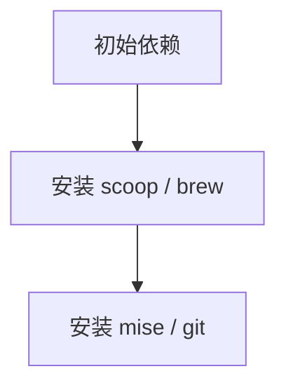
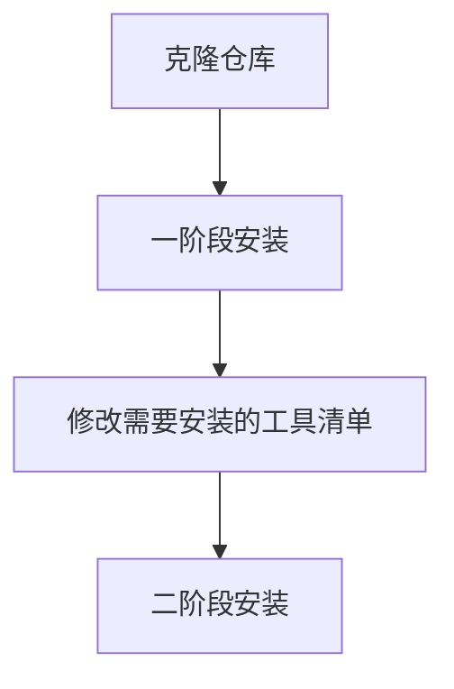
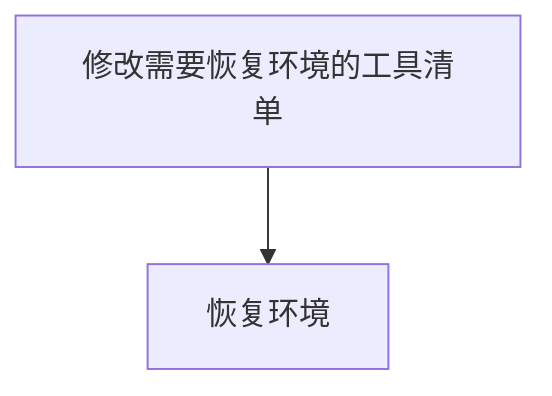
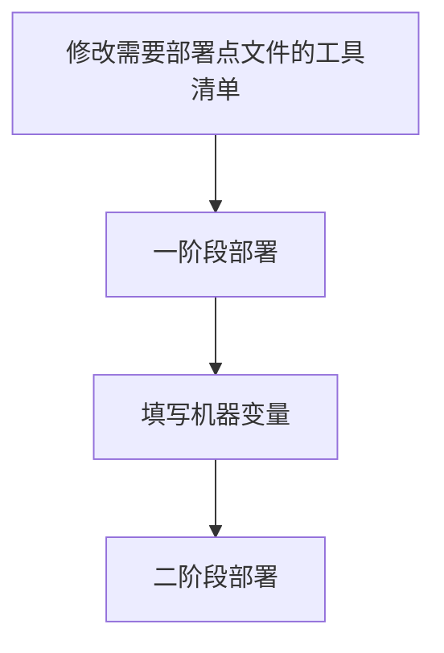

# 初始化流程

本文讨论机器初始化的流程设计，不讨论具体实现。具体操作方式请参考 [README.md](../README.md#机器初始化)

目前初始化分为四个阶段。

## 0 完成自举

此阶段的目标是根据初始依赖安装自举需要的工具。

对于 Windows

- 依赖：`powershell`
- 产物：`scoop` + `git` + `mise`
- 脚本：[seed.ps1](../seed.ps1)

对于 Linux

- 依赖：`curl` + `bash` + `git`
- 产物：`brew` + `mise`
- 脚本：[seed.sh](../seed.sh)

流程为

## 1 安装工具

此阶段的目标是用已有的 `git` + `mise` 和包管理器安装工具

- 对于 Windows，包管理器为 `scoop` + `winget`
- 对于 Linux，包管理器为 `brew`

流程为

## 2 恢复环境

此阶段的目标是对部分已安装的工具，根据仓库中的清单，恢复需要用到的插件、扩展等。这步需要网络。

流程为

## 3 部署点文件

此阶段的目标是对部分已安装的工具，根据仓库中的配置，部署需要用到的点文件。这步不需要网络。

流程为

至此初始化完成，进入持续维护阶段。
