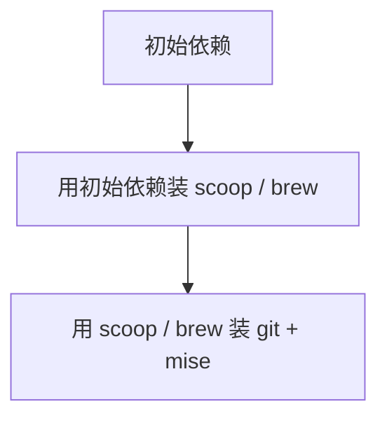
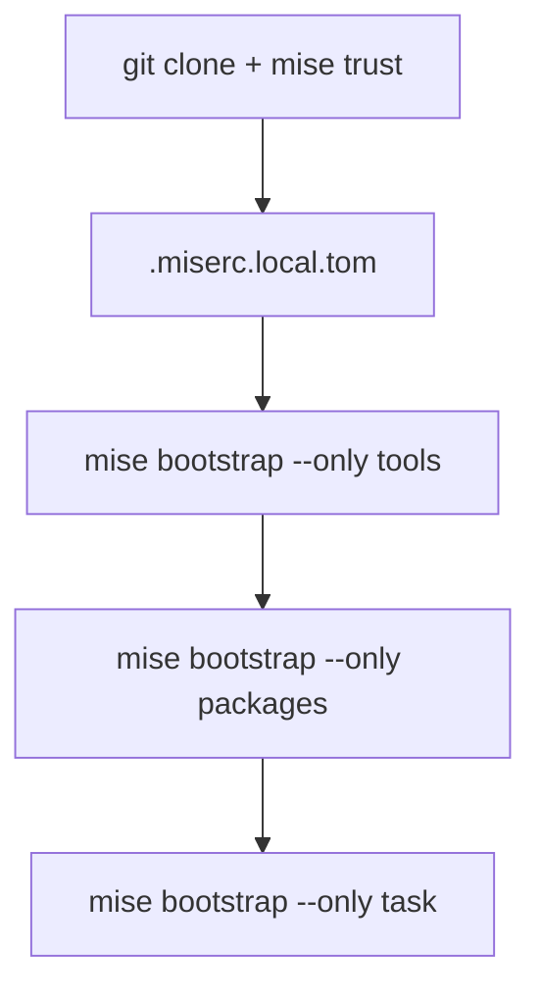

# 初始化流程

本文讨论机器初始化的流程，分为非自举阶段和可自举阶段。

## stage 0

stage 0 无法自举。目标是根据初始依赖安装自举需要的工具。

对于 Windows

- 依赖：`powershell`
- 产物：`scoop` / `git` / `mise`
- 脚本：[seed.ps1](../seed.ps1)

对于 Linux

- 依赖：`curl` / `bash`
- 产物：`brew` / `git` / `mise`
- 脚本：[seed.sh](../seed.sh)

流程为

## stage 1

stage 1 可以自举。

流程为

### 改动清单

- [ ] README 里增加一段通过 raw URL 执行 `seed.ps1` / `seed.sh` 的说明
- [ ] `.mise/config.{scoop,wsl,msvc,brew}.toml` 的 `pre-packages` hook 改为直接调脚本，不再依赖 just（有待考虑）
